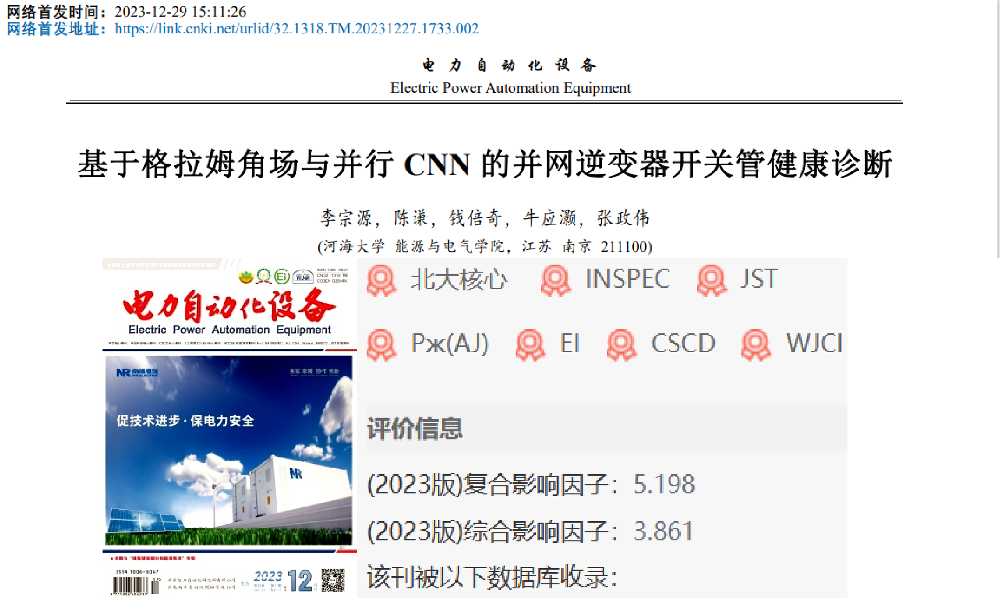
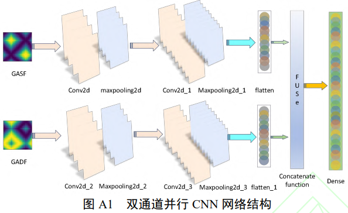
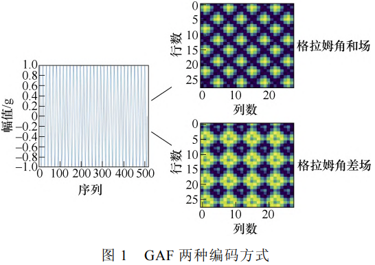
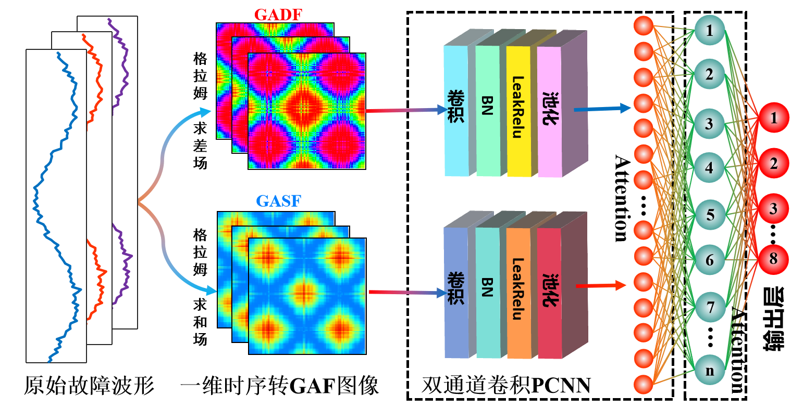
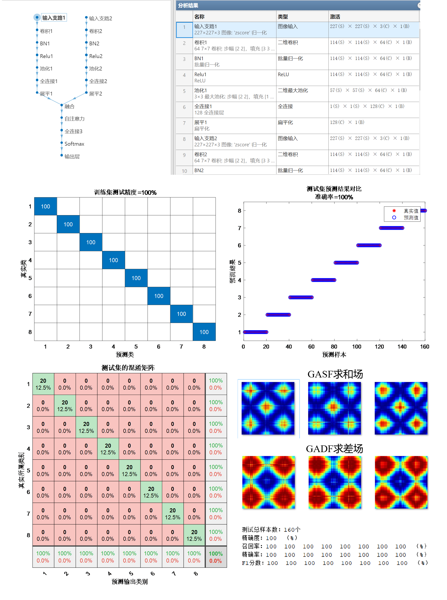
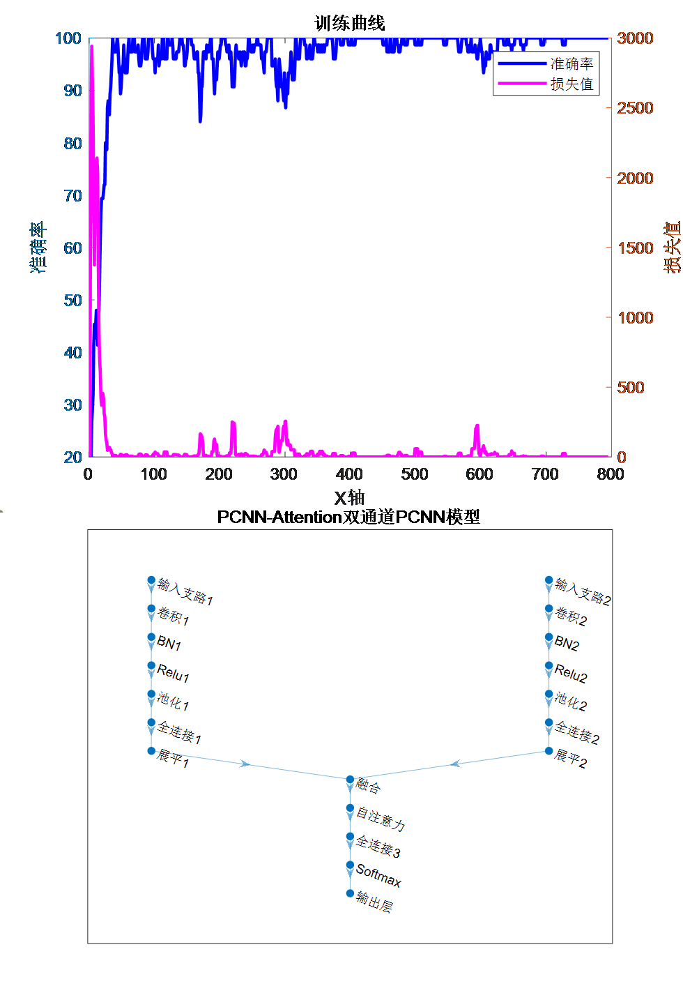

# New approach to the paper! Dual-channel convolution! GAF-PCNN-MSA Gram Angle Field and dual-channel PCNN with attention mechanism for classification/fault identification programs! Run directly.

Applicable Platform: MATLAB 2023 version and above.
The program is well commented, packed with valuable information. Below is a brief introduction to the article and the program!

Document Interpretation: In this document, firstly, one-dimensional fault voltage and current signal sequences are collected; secondly, they are transformed using the Gram angle field, converting both one-dimensional time series signals into Gram sum fields and Gram difference fields. Finally, the two sets of images generated are simultaneously fed into a CNN for parallel learning and training, achieving inverter fault diagnosis.

Gram Angle Field Principle: The Gram Angle Field (GAF) is a method for converting one-dimensional sequences into images. It consists of Gram Sum (GASF) fields and Gram Difference (GADF) fields. It encodes the time series under the Cartesian coordinate system as polar coordinates, then generates the Gram matrix through trigonometric operations, thereby transforming one-dimensional time series into two-dimensional images. The converted images can retain the temporal dependence and potential connection features of the data while also having a large sparsity, eliminating redundant information between multiple modalities.

Model Improvement: Our proposed model makes improvements on the above model: adopting a dual-branch structure, only requiring original fault waveform data to transform one-dimensional sequences into two-dimensional Gram angle field images. One branch is for GASF sum field input through CNN to extract and feature the image, and the other branch is for GADF Gram difference field input through CNN to extract the difference field image features, realizing the fusion of high-dimensional image features from two categories. Additionally, by incorporating Multi-head Self Attention (MSA), we effectively grasp the contribution level of extracted features, strengthening them and improving the accuracy of fault recognition. We also calculate evaluation indicators such as precision, recall, accuracy, F1 score, etc. The fault recognition process is as follows:

Innovation Points:
1. Time-series imageization: Converting one-dimensional fault waveforms into two-dimensional images, allowing the time series to be transformed into a table, fully leveraging the advantages of deep learning in image vision to extract features such as color texture after waveform conversion.
2. Multi-channel input: Fusing two-dimensional GASF and GADF images, which can comprehensively utilize information from different Gram angle fields, thereby more comprehensively describing the characteristics of the data. This helps in extracting richer and more distinctive features, thus improving the accuracy of classification and recognition.
3. Spatial feature learning: Convolutional Neural Networks (CNN) perform excellently in image processing, effectively learning spatial features and local patterns of images. Using CNN for processing image data can help extract features such as texture, shape, and edges of images, aiding in more accurate classification and fault identification.
4. Merging advantages: By integrating information from different image modalities, the algorithm can compensate for the limitations of each type of two-dimensional image. For example, GASF images may be more sensitive to certain fault patterns, while GADF is more sensitive to others. Combining them together can enhance the algorithm's robustness and generalization capabilities.
5. Multi-head self-attention mechanism: The integration of multi-head attention mechanisms (MSA) effectively grasps the contribution of extracted features, focusing on strengthening these features to improve the accuracy of fault identification.
6. Enhancing generalization capability: Multi-modal fusion can help algorithms better understand the essential features of data, thereby reducing the risk of overfitting and enhancing the algorithm's generalization ability on new data.
Applicable fields: Suitable for various data classification scenarios, such as rolling bearing faults, transformer oil gas faults, power system transmission line fault areas, insulators, distribution networks, and disturbances in electric energy quality, etc., for recognition, diagnosis, and classification.
Data format: One sample per row, with the last column being the fault type label. Program results: (Automatically converted from the one-dimensional sequence to Gram images)

## Images

<!-- PAYMENT_BLOCK -->

## Get this dataset

- Payment link (Stripe): [Buy now](https://buy.stripe.com/3cs8yP7sY87d0vu9AB)
- Payment QR code: 

<!-- /PAYMENT_BLOCK -->
